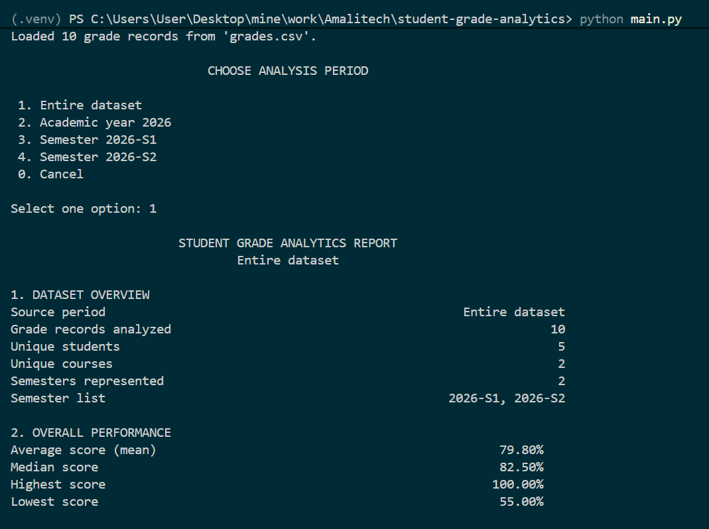

# Student Grade Analytics Tool

A command-line tool that reads student grades from a CSV file, works out the
statistics that matter (averages, distributions, rankings, semester trends),
shows them in a terminal dashboard, and saves the results as a JSON report.

It was built for the Python Advanced lab, so it leans on the standard
library's collections, dataclasses, and type hints rather than third-party
packages.

## Setup

You need **Python 3.11 or newer**. The file picker uses Tkinter, which comes
with the standard Python installers for Windows and macOS. On Linux you may
need to install it separately (for example `sudo apt install python3-tk`).

```powershell
git clone https://github.com/Aline-CROIRE/student-grade-analytics.git
cd student-grade-analytics

python -m venv .venv
.\.venv\Scripts\Activate.ps1        # macOS/Linux: source .venv/bin/activate

python -m pip install -r requirements.txt
```

`requirements.txt` only contains development tools (pytest, mypy, Ruff, Black,
coverage). The tool itself has no third-party dependencies.

## Running the tool

```powershell
python main.py
```

1. A file picker opens. Choose a grades CSV, such as `data/grades.csv`.
2. If a `students.csv` file sits in the same folder, it is loaded too and
   the report adds performance by major and year of study.
3. Pick what to analyse: the whole dataset, one academic year, or one
   semester.
4. Read the dashboard, then choose to export, analyse another period, open
   another file, or exit.

Exports are saved to `reports/<csv name>_<period>_report.json`, with a
matching `.txt` copy of the dashboard. If a report already exists, the tool
asks before replacing it.

## Sample input

`data/grades.csv` has one row per grade. Semesters use the `YYYY-S1` or
`YYYY-S2` format, and scores must be between 0 and 100.

```csv
student_id,course_id,score,semester
S001,CS101,80,2026-S1
S001,CS102,90,2026-S1
S002,CS101,60,2026-S1
S002,CS102,70,2026-S2
S003,CS101,100,2026-S2
```

`data/students.csv` is optional and has one row per student:

```csv
student_id,name,major,year
S001,Alice,Computing,2
S002,Brian,Engineering,1
S003,Chloe,Computing,3
```

Invalid files are rejected with a message that names the problem and the row,
for example `Invalid semester on row 2: Invalid semester 'S1'; expected
format YYYY-S1 or YYYY-S2`. A missing file, a file you are not allowed to
read, or a malformed CSV is reported the same way, and you can pick another
file.

## Sample output

Part of the dashboard for the full sample dataset:

```text
5. STUDENT RANKINGS
Rank    Student ID               Average    Percentile    Grades
1       S003                      92.50%       100.00%         2
2       S005                      91.50%        80.00%         2
3       S001                      85.00%        60.00%         2
4       S002                      65.00%        40.00%         2
4       S004                      65.00%        40.00%         2

7. PERFORMANCE BY MAJOR AND YEAR
Major                         Students      Grades       Average
Business                             1           2        65.00%
Computing                            2           4        88.75%
Engineering                          2           4        78.25%

8. SEMESTER TRENDS
Semester           Average   Rolling avg          Change     Direction
2026-S1             76.00%        76.00%             N/A      Baseline
2026-S2             83.60%        79.80%        +7.60 pp      Improved
```

Students with the same average share a rank. Grades are A (90+), B (80+),
C (70+), D (60+) and F (below 60), and 60 is the pass mark.



## JSON report example

An excerpt of `reports/grades_entire_dataset_report.json` for the sample
data. Some sections are shortened here; the real file lists every student,
course and group.

```json
{
  "summary": {
    "count": 10,
    "mean": 79.8,
    "median": 82.5,
    "minimum": 55.0,
    "maximum": 100.0
  },
  "modes": [],
  "mode_frequency": 1,
  "grade_distribution": { "A": 3, "B": 3, "C": 2, "D": 1, "F": 1 },
  "student_performance": {
    "S003": { "average": 92.5, "grade_count": 2, "percentile_rank": 100.0, "rank": 1 }
  },
  "top_performers": [
    { "student_id": "S003", "average": 92.5, "rank": 1 },
    { "student_id": "S005", "average": 91.5, "rank": 2 },
    { "student_id": "S001", "average": 85.0, "rank": 3 }
  ],
  "semester_trends": [
    { "semester": "2026-S1", "average": 76.0, "change": null, "rolling_average": 76.0 },
    { "semester": "2026-S2", "average": 83.6, "change": 7.6, "rolling_average": 79.8 }
  ],
  "major_performance": {
    "Computing": { "student_count": 2, "grade_count": 4, "average": 88.75 }
  },
  "insights": [
    "The average score is 79.80%, above the 60% passing threshold.",
    "Top performer: S003 with a 92.50% average.",
    "The average increased by 7.60 percentage points in 2026-S2 compared with the previous recorded semester."
  ]
}
```

The full report also includes `dataset_overview`, `pass_fail`,
`course_performance` and `year_performance`. Its structure is defined by the
`GradeReport` TypedDict in `src/grade_analytics/json_report.py`, and numbers
are rounded to two decimal places.

## Collection performance notes

| Collection | Where it is used | Why |
|---|---|---|
| `Counter` | Grade distribution and most frequent scores | Counts in one pass |
| `defaultdict` | Grouping grades by student and course, and students by major and year | No need to check whether a group exists first |
| `OrderedDict` | Grade distribution in A–F order | Keeps the report order fixed |
| `deque(maxlen=n)` | Rolling average of semester averages | Old values drop off automatically, and adding is O(1) |
| `namedtuple` / `dataclass` | `GradeSummary`, and the `Student`, `Course` and `Grade` models | Named fields instead of loose dictionaries |

### Measured memory use

To compare these choices with real numbers, run:

```powershell
python -m src.grade_analytics.memory_comparison
```

It uses `tracemalloc` to measure 100,000 grade records held in different
ways. These are the results on Python 3.14.8 (Windows):

| Storage | Total | Bytes per record |
|---|---:|---:|
| `dataclass(slots=True)` | 7,032 KiB | 72 |
| `tuple` | 8,595 KiB | 88 |
| `namedtuple` | 9,376 KiB | 96 |
| `dataclass` | 10,941 KiB | 112 |
| `dict` | 18,749 KiB | 192 |

For a rolling average, a `deque(maxlen=5)` stayed at about 1.3 KiB after
receiving 100,000 scores, while a list keeping every score used 781 KiB.

What this means in practice:

- Dictionaries are the most flexible but cost about 2.7 times as much as a
  slotted dataclass. Typed models are smaller and easier to check.
- `slots=True` removes the per-object `__dict__`, which saves about a third
  compared with a normal dataclass.
- When you only need the latest few values, a bounded `deque` keeps memory
  flat no matter how much data arrives.
- For large files, `iter_grades_from_csv()` is a generator that yields one
  validated record at a time instead of building the whole list.

Building the report makes a few passes over the grades, so it runs in
O(N log N) time (sorting for the median and rankings) and uses O(N) memory.

## Running the tests

```powershell
pytest
```

The test suite covers every collection type, the calculations, CSV
validation, the JSON export, the dashboard, and the shipped sample data.
To run the code-quality checks as well:

```powershell
ruff check .
black --check .
mypy src main.py
```

## Project structure

```text
data/                 sample grades.csv and students.csv
docs/                 assignment brief, audit tracker, screenshot
src/grade_analytics/
  models.py           Student, Course and Grade dataclasses
  csv_loader.py       CSV reading and validation (with a generator)
  collections_utils.py  Counter, defaultdict, OrderedDict, deque helpers
  analytics.py        mean, median, mode, percentiles
  semester_trends.py  semester averages and rolling average
  json_report.py      report building and JSON export
  terminal_ui.py      dashboard and text export
  memory_comparison.py  memory measurements
tests/                pytest tests
main.py               interactive application
```

## Author

Aline NIYONIZERA ([Aline-CROIRE](https://github.com/Aline-CROIRE))
